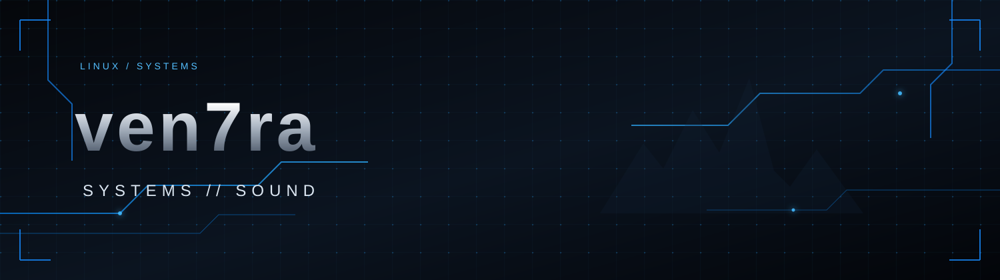

<div align="center">



### `SYSTEM ADMINISTRATOR` &nbsp;·&nbsp; `MUSIC PRODUCER`

[Website](https://muz.lc/ven7ra) · [GitHub](https://github.com/ven7ra)

</div>

---

```text
┌─ ven7ra ────────────────────────────────────────┐
│  System administration, technology and sound.   │
│  Exploring reliable systems and creative tools. │
└─────────────────────────────────────────────────┘
```

## `> who am i`

I'm a system administrator and music producer interested in the space between technology and creativity.

- 🖥️  Systems, infrastructure and day-to-day administration
- ⚙️  Automation, scripting and practical tooling
- 🎧  Music production and sound design

## `> focus areas`

<p>
  
  
  
</p>

</div>

## `> connect`

- 🌐 Website: [muz.lc/ven7ra](https://muz.lc/ven7ra)
- 🐙 GitHub: [@ven7ra](https://github.com/ven7ra)

---

<div align="center">

`ven7ra` &nbsp; **|** &nbsp; `forever`

</div>
